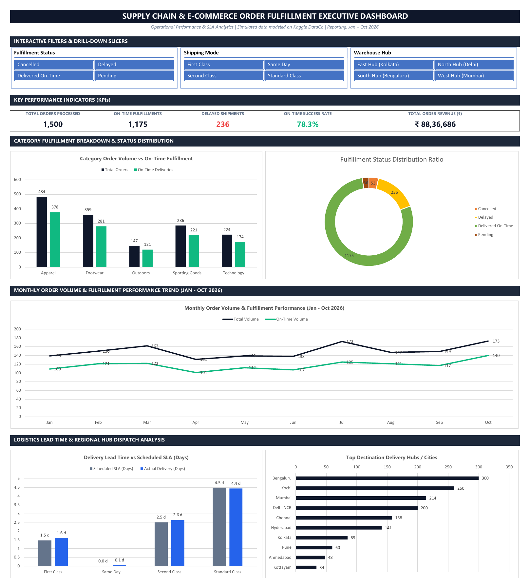
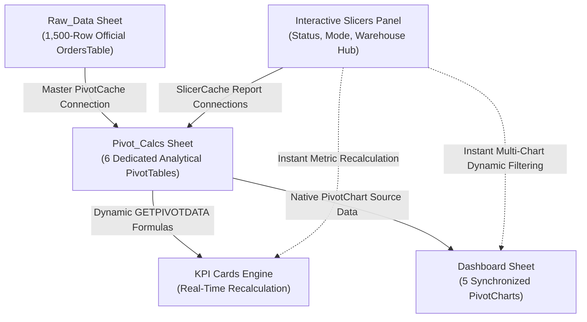

# Supply Chain & E-Commerce Order Fulfillment MIS Dashboard (Excel)

[](https://products.office.com/excel)
[](https://www.kaggle.com/datasets/shashwatwork/dataco-smart-supply-chain-for-big-data-analysis)
[](https://opensource.org/licenses/MIT)

An end-to-end executive **Management Information System (MIS) Dashboard** built in Microsoft Excel analyzing **a simulated 1,500-order dataset modeled on the structure of Kaggle's DataCo Supply Chain dataset (same type of fields, not the same data or rates)**. The dashboard monitors order fulfillment velocity, delivery SLA compliance, freight expenditure, and regional logistics bottlenecks across 10 destination cities and 4 warehouse hubs.

---

## 📌 Executive Dashboard Preview



> **Live File**: Open [`Supply_Chain_Fulfillment_MIS_Dashboard.xlsx`](Supply_Chain_Fulfillment_MIS_Dashboard.xlsx) in Microsoft Excel to interact with the clickable native Slicers and dynamic Pivot calculations.

---

## 📁 Dataset Scope & Data Generation

> [!NOTE]
> **Simulated Dataset vs. Full Kaggle Dataset Disclosure**:
> * The complete raw [Kaggle DataCo Global Supply Chain Dataset](https://www.kaggle.com/datasets/shashwatwork/dataco-smart-supply-chain-for-big-data-analysis) contains **180,519 rows and 53 columns (~95.9 MB)** covering multi-year global supply chain transactions.
> * For this executive Excel MIS dashboard, **the full 180K+ row dataset was intentionally not loaded into the spreadsheet**. Instead, **a simulated 1,500-order dataset modeled on the structure of Kaggle's DataCo Supply Chain dataset (same type of fields, not the same data or rates)** was used. Rows were generated programmatically by a Python script rather than sampled directly from DataCo rows, establishing realistic delivery lead times, order values, and fulfillment statuses for executive reporting (January – October 2026).
> * **How the data was built**: All 1,500 rows were generated by a Python script. The dates (Jan–Oct 2026), warehouse hubs, destination cities, INR order values and shipping costs, five product categories and delivery outcomes were generated for this portfolio project. None are real transactions or DataCo rows.

### Why 1,500 Rows for the Excel MIS Dashboard?
1. **Excel Performance & Instant Slicer Interactivity**: The dataset was kept small so PivotTables and slicers stay fast, ensuring sub-second filtering with zero UI latency.
2. **Repository Portability & Accessibility**: Keeps the workbook lightweight (~220 KB) and eliminates the need for Git LFS (Large File Storage), allowing recruiters, hiring managers, and stakeholders to immediately clone, view, and interact with the file in standard Microsoft Excel without performance bottlenecks.
3. **Pattern-Based Modeling**: The simulated 1,500-order dataset was generated by a Python script to model operational supply chain workflows across 4 shipping tiers (*Same Day*, *First Class*, *Second Class*, *Standard Class*) and 5 core consumer merchandise lines.

---

## 📊 Executive Summary & Key Performance Indicators (Jan – Oct 2026)

```text
======================================================================================================
LOGISTICS HEALTH & SLA PERFORMANCE AT A GLANCE (1,500 ORDERS)
======================================================================================================
Total Orders Processed : 1,500 Orders
On-Time Deliveries     : 1,175 Orders (78.33% Fulfillment Rate)
Delayed Shipments      : 236 Orders (15.73% Delay Rate)
Cancelled              : 53 Orders (3.53%)
Pending / In-Transit   : 36 Orders (2.40%)
Total Order Value      : ₹ 88,36,686 (~$106K USD)
======================================================================================================
```

### 🔍 Key Business Findings:
Based on the 10-month simulated dataset (findings are illustrative, not real-world results):
1. **The Fulfillment SLA Gap**: 78.33% of shipments arrived strictly on schedule, leaving **15.73% (236 shipments)** delayed. On-time rate is 78.3% of all orders and 83.3% of delivered orders (1,175 of 1,411).
2. **Category Demand Volume**: **Apparel (484 orders)** and **Footwear (359 orders)** represent **56.2% of total order volume**, requiring dedicated buffer stock and prioritized carrier allocation.
3. **Logistics Lead-Time Variance**:
   - **Same Day**: Scheduled 0.0 days vs. Actual 0.1 days (89.8% of Same Day orders on time, 6.8% delayed).
   - **First Class**: Scheduled 1.5 days vs. Actual 1.6 days (Minimal variance).
   - **Second Class**: Scheduled 2.5 days vs. Actual 2.6 days.
   - **Standard Class**: Scheduled 4.5 days vs. Actual 4.4 days (Largest absolute volume of delayed shipments).
   - Delay rates by shipping mode: First Class 18.2%, Second Class 17.5%, Standard Class 15.2%.
4. **Regional Hub Concentration**: **Bengaluru (300 orders)**, **Kochi (260 orders)**, and **Mumbai (214 orders)** account for over **51.6% of orders by destination city**, identifying South and West distribution corridors as critical operational arteries.

---

## 🛠️ Dashboard Architecture & Visual Design

The dashboard follows modern enterprise MIS design principles with zero gridline clutter, high-contrast visual hierarchy, and instant drill-down capabilities:

### 1. Interactive Slicer Panel
* **Fulfillment Status Slicer**: Filter by *Delivered On-Time*, *Delayed*, *Cancelled*, and *Pending*.
* **Shipping Mode Slicer**: Multi-select across *Standard Class*, *Second Class*, *First Class*, and *Same Day*.
* **Warehouse Hub Slicer**: Real-time drill down into *North Hub (Delhi)*, *South Hub (Bengaluru)*, *West Hub (Mumbai)*, and *East Hub (Kolkata)*.

### 2. Dual-Series Category Clustered Column Chart
* Compares **Total Order Volume (Navy Blue)** against **On-Time Deliveries (Emerald Green)** across *Apparel*, *Footwear*, *Outdoors*, *Sporting Goods*, and *Technology*, instantly highlighting fulfillment efficacy per merchandise line.

### 3. Fulfillment Status Donut Distribution
* Clear proportional breakdown with leader lines:
  * 🟢 **78% Delivered On-Time**
  * 🔴 **16% Delayed Shipments**
  * 🟡 **4% Cancelled Orders**
  * 🟣 **2% Pending / In-Transit**

### 4. Dual-Metric Monthly Trend Line (Jan – Oct 2026)
* Visualizes dispatch velocity from **139 orders in January** to a peak of **173 orders in October** with distinct marker geometries and independent data label positioning (above for total volume, below for on-time deliveries).

### 5. Delivery SLA Lead Time vs. Scheduled Commitment
* Clustered column visual tracking scheduled delivery commitments against real-world transit days across all shipping tiers.

### 6. Top Destination Delivery Hubs
* Horizontal bar chart ranking the top 10 destination cities to guide carrier contract renegotiations and hub expansion.

---

## 🧩 Technical Implementation & Excel Engineering

The project implements a modern **3-Sheet Model Architecture** leveraging native Excel **PivotTables**, **PivotCharts**, and synchronized **Slicer Report Connections** with dynamic `=GETPIVOTDATA(...)` formulas:



### Advanced Excel Engineering Features:
* **Native Multi-Pivot Slicer Synchronization (Report Connections)**:
  Three interactive Slicers (`Fulfillment_Status`, `Shipping_Mode`, `Warehouse_Hub`) are bound via programmatic **Report Connections** across all 6 underlying PivotTables. Selecting or deselecting any slicer item dynamically and instantaneously re-filters all 5 charts and KPI cards simultaneously.
* **Dynamic KPI Metric Engine (`GETPIVOTDATA`)**:
  Rather than static range formulas, executive KPI summary cards evaluate the visible PivotTable cache via:
  ```excel
  =GETPIVOTDATA("Orders_Count", Pivot_Calcs!$B$2)
  =GETPIVOTDATA("OnTime_Sum", Pivot_Calcs!$B$2)
  =GETPIVOTDATA("Delayed_Sum", Pivot_Calcs!$B$2)
  =IFERROR(C11/C10, 0)
  =GETPIVOTDATA("Total_Revenue", Pivot_Calcs!$B$2)
  ```
  This keeps the KPI cards linked to the filtered PivotTable.
* **Automated Data Normalization & Flagging**:
  Helper boolean flags (`Is_On_Time`, `Is_Delayed`) embedded in the transactional data table enable dual-metric summations within a single unified PivotTable.
* **Field Button Suppression & Publication Cleanliness**:
  All native PivotChart field buttons and filter dropdown pills are suppressed (`ShowAllFieldButtons = False`) to maintain a clean, publication-ready executive aesthetic.

---

## 🚀 Business Recommendations & Actionable Strategy

Based on the 10-month simulated dataset (findings are illustrative, not real-world results):
1. **Investigate First Class and Second Class delays**: they have the highest delay rates (18.2% and 17.5%) despite shorter lead times. Standard Class (55% of volume, 15.2% delay rate) averages 4.4 actual vs 4.5 scheduled days.
2. **South Corridor Forward-Deployment**: With Bengaluru and Kochi driving 560 orders (37.3% of total volume), establish dedicated micro-fulfillment hubs in South India to compress regional transit lead times toward sub-24-hour fulfillment.
3. **Automated Delay Exception Alerts**: Trigger real-time customer notification for orders flagged with `Actual_Days > Scheduled_Days` by Day 3 to proactively curb customer cancellations.

---

## 📂 Repository Contents

```text
supply-chain-fulfillment-excel-mis/
├── dashboard/
│   └── Supply_Chain_Fulfillment_MIS_Dashboard.xlsx   # Main Excel workbook with Raw_Data, Pivot_Calcs & Dashboard UI
├── data/
│   ├── DescriptionDataCoSupplyChain.csv              # Kaggle DataCo metadata dictionary & column definitions
│   └── orders_fulfillment_dataset_1500.csv           # Simulated 1,500-order shipment dataset
├── documentation/
│   └── Supply_Chain_Fulfillment_MIS_Dashboard.pdf    # Clean 1-page vector PDF export of the executive dashboard
├── screenshots/
│   └── Supply_Chain_Fulfillment_MIS_Dashboard.png    # High-resolution dashboard image for preview & documentation
├── .gitattributes                                    # Git line-ending configurations & binary file attributes
├── .gitignore                                        # Excludes temporary Excel lock files (~$*) and system cache
├── LICENSE                                           # MIT License (2026 Rohith Chandran E)
├── README.md                                         # Project documentation, architecture & business insights
├── Supply_Chain_Fulfillment_MIS_Dashboard.pdf        # Root convenience copy of executive PDF export
├── Supply_Chain_Fulfillment_MIS_Dashboard.png        # Root convenience copy of dashboard preview image
└── Supply_Chain_Fulfillment_MIS_Dashboard.xlsx       # Root convenience copy of interactive Excel workbook
```

---

## 👤 Author & Contact

**Rohith Chandran E**  
*Aspiring Data Analyst & MIS Professional*  
* **LinkedIn**: [linkedin.com/in/rohithchandrane](https://www.linkedin.com/in/rohithchandrane)  
* **GitHub**: [github.com/rohithce-hub](https://github.com/rohithce-hub)  
* **Email**: rohith.e.chandran@gmail.com
